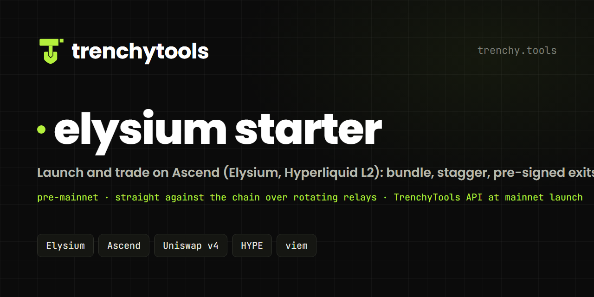

<!-- trenchytools:header -->
<p align="center"></p>

<p align="center"><a href="https://elysium.trenchy.tools">Live demo</a> · <a href="https://trenchy.tools/docs">Docs</a> · <a href="https://github.com/Trenchy-Tools">All starters</a> · <a href="https://app.ascendlaunch.xyz">Ascend</a> · <a href="https://elyscan.io">Elyscan</a></p>

# elysium starter

A launch and trading tool for **Ascend** on **Elysium** (Kinetiq's Hyperliquid L2, chain id 99901, native HYPE).
One Next.js app, one process, one `npm run dev`. A sibling of the pons starter with the same theme and the same
wallet folder; what differs is how a coin is made and how fast it is sold.

**One codebase, three launchpads.** This is the Ascend edition: the Launch page opens on Ascend. The same app also
launches on **Montra** and **BOXA** (pick the pad at the top of the Launch page) and trades coins from all three, finding
each coin's pool by itself. The same code opened on the other pads ships as
[trenchytools-montra-launcher](https://github.com/Trenchy-Tools/trenchytools-montra-launcher) and
[trenchytools-boxa-launcher](https://github.com/Trenchy-Tools/trenchytools-boxa-launcher); their READMEs walk through
how a launch works on each.

> ### Pre-mainnet build
> Elysium has no official public RPC until its public mainnet launch, so this build **talks to the chain itself over
> a rotating set of community relays** (Agoradex, Volta, Kleos, ElysPump): reads run over the fastest ones, every
> signed transaction is broadcast to all of them at once and the first acceptance wins. There is no API key, no
> account and nothing in the middle. **At the public mainnet launch the same app moves onto the
> [TrenchyTools API](https://trenchy.tools/docs)** (one key, the API builds and simulates every transaction, you
> sign locally), exactly the way the pons and pump.fun starters work today, and the relay list becomes a fallback.
> Everything else in this README stays the same.

> **API note** — this app talks to the [TrenchyTools API](https://trenchy.tools) (`api.trenchy.tools`), a third-party hosted API (we're not affiliated, it's just the convenient one). It handles the chain calls, Jito bundles and IPFS pinning. Pointing it at QuickNode, Helius or your own RPC instead needs extra code.


## What each feature talks to

| Feature | Today (pre-mainnet) | At the mainnet launch |
| --- | --- | --- |
| Launch (`launchChecked`, dev buy, metadata suffix) | `EscrowFactory` on chain via the relays | `POST /api/ely/trade-local { action: "create" }` |
| Buys and sells | Universal Router / the wallet's desk, calldata built in `lib/elysium/v4.ts` | `POST /api/ely/trade-local { action: "buy" \| "sell" }` |
| Dry run | `eth_simulateV1` over the relays (the whole wrap → approve → create sequence) | `POST /api/ely/simulate` |
| Live trades, outside-flow gates, auto-sell triggers | the pool's `Swap` logs, polled every 600 ms | `wss://…/api/ely/data` |
| Image + metadata | IPFS (QuickNode or Pinata key in `.env`) | `POST /api/ipfs` |
| Creator fees | `CreatorEscrow` on chain | `GET /api/ely/creator-fees` |
| HYPE price for the dollar bars | Hyperliquid `allMids` | the same |

## What it is

- **Wallets**: one list, each wallet a file in `./wallets`. **+ New wallet** (× N) or **Import ▾** a 0x key; the first
  one becomes ★, the main wallet that pays for everything and receives gathers (click ☆ to move it). Per row **Fund**
  (from ★) and **Key**; tick rows for **Amount each · Fund from ★ · Gather to ★ · Send ▾ · Export keys · Archive**.
  Every send is direct, wallet to wallet, through every relay at once.
- **Launch**: name, symbol, image, socials, the **trade fee** the pool keeps for ever (1–10 %), the dev buy, the
  **auto-sell** armed the moment the coin exists, how many **bundle buyers** and **holder wallets** buy with it. A dry
  run lists every chain call; the launch shows a live log of every hash and opens the Trading page on the coin.
- **Trading**: every wallet in a row with **[amount] Buy** and **25 / 50 / 100 %** sell buttons; tick rows to act across
  the selection or add a timed sell; the coin's trades on the right from the chain's own swap logs, 600 ms apart. The
  **Desk** card and the **Auto-sell** card sit above **Creator fees** (claim what the escrow holds).

The app holds your keys and signs locally with [viem](https://viem.sh). Reads go over the fastest community relays;
every signed transaction is broadcast to **all** of them at once and the first acceptance wins (the chain has one
sequencer, the relays are only doors to it). No database, no login, no encryption layer: a local, single-user tool.

## 5-minute start

```bash
git clone https://github.com/Trenchy-Tools/trenchytools-elysium-launcher && cd trenchytools-elysium-launcher
npm install
cp .env.example .env     # relays (optional), an IPFS pinning key (QuickNode or Pinata) for the coin's image
npm run dev
```

Open http://localhost:3000. The status dot in the top bar says whether the relays answer and whether a ★ wallet
exists; click it for Settings. On **Wallets**, press **+ New wallet** (it becomes ★) and send it some HYPE on Elysium
(MetaMask: chain id 99901, RPC `https://rpc.agoradex.app`, symbol HYPE). Start with small sizes and press **Dry run**
before the first launch.

## Where your keys are

Every wallet is a JSON file in one folder:

| Setting                   | Folder                                      |
| ------------------------- | ------------------------------------------- |
| `WALLET_BACKUP_DIR` set   | that folder                                 |
| otherwise                 | `./wallets` (inside the clone, git-ignored) |

Files are named `<date>-ely-<role>-<0xaddress>.json` and hold
`{ publicKey, privateKey, chain: "ely", role, label, createdAt, app, note }`; every wallet is also one line in
`wallets.csv`. The folder can be shared with the other starters (they write `chain: "sol"` / `"rh"` files); this app
lists only `chain: "ely"`. Its own state (settings incl. the ★ wallet, launch records, desks, armed exits) sits in
`_app/elysium-starter/`; archived wallets' files move to `archived/` (keys kept, never used).

The folder **is** the store. The app writes a file **before** a create or import returns, and refuses to fund, launch
with, trade with or gather from any wallet whose file is missing (HTTP 409 `not_backed_up`). Back the folder up like
you would a seed phrase: anyone with a file controls that wallet.

## How a launch works on Ascend

The Launch page in one look: a big **DEV WALLET** block (creates the coin, pays every buyer, receives the dev bag),
the dev buy, the trade fee, the **Auto-sell** switch with its rules, **Bundle buyers** (all at once on confirm) and
**Staggered buyers** (one after another, gated on outside flow).

Ascend is a Uniswap v4 launchpad: every coin starts in its own v4 pool (fee flag `0x800000`, tick spacing 200) with the
Launchpad hook taking the trade fee, and graduates when it holds a $40k market cap for an hour. The app does what the
site does, minus the site:

1. **The image and the metadata are pinned first.** `POST /api/launch/image` pins the image, then Ascend's metadata
   JSON (`ascend-metadata-1`: name, symbol, description, image, links) around it. The metadata URI rides the launch
   calldata as a suffix (`abi.encode("ascend.metadata.v1", uri)`), the way the site's own launches carry it.
2. **One transaction creates the coin, the pool and the dev buy.** `EscrowFactory.launchChecked(params, receiver,
   ruleSet, startTick)` with the dev buy as `value`. The **dev bag goes to the wallet's desk** when it has one, so the
   first sell is one call with nothing to approve.
3. **The buys go out the moment the launch confirms.** Every bundle wallet's buy is signed with its own nonce and
   fanned out to every relay at once; a wallet with a desk buys through it. Wallet-held buyers get their two
   approvals (ERC20→Permit2, Permit2→router) fired back to back right after, so their sells are ready.
4. **The auto-sell is armed before anyone else can buy.** A sell is pre-signed for every wallet that holds the coin
   (desk sells where the coin sits in a desk) and fired on the first trigger: **$ net outside money in**, or **the next
   outside buy of at least N HYPE**. Your own wallets and desks never trigger it.

**Cost** (right-hand card): per buy, HYPE + a 0.002 HYPE gas reserve; the launch itself is ~5.2M gas at the chain's
0.1–0.3 gwei, and Ascend charges no creation fee. The shortfall is what ★ sends at launch (`fundFirst`, on by default).
**Dry run** runs every transaction through `eth_call` on the live chain; nothing is sent.

**Trade fee.** The pool's fee is fixed at launch (1–10 %). Ascend's cut comes out of the first 1 %; everything above
it is the creator's and claimable as it accrues. At exactly 1 % the creator's share is **held** in the escrow until the
coin graduates.

## Buying with other wallets: bundle or stagger

- **Bundle buyers** buy the instant the launch confirms (up to 16), each with its own nonce, fanned out to every relay.
  No gate: they are part of the launch.
- **Staggered buyers** buy one at a time after the launch under rules you set on the form: first buy after N s, a
  random gap between buys, and a **gate on outsiders' net buying** over the last window (their buys minus their
  sells; our own wallets and desks never count). Below the floor means nobody is here yet, above the cap means bots
  are piling in; either way the wallet waits and re-checks every 2 s, and is skipped after its give-up time. The run
  stops the moment one of our wallets sells. Every verdict is written to the launch log.

## Auto-sell: optional, per wallet

The **Auto-sell** switch arms, the moment the coin exists, a sell pre-signed for every wallet that holds it. Two
"sell everything" rules (both optional): `$` net outside in, or the next outside buy of at least N HYPE. On top, every
wallet, the dev included, can carry its own bar: **sells @ outside HYPE in ≥ X**, where *outside HYPE in* is the HYPE
strangers have net-put into the coin since launch. S1 at 1, S2 at 3, dev at 8 means S1's pre-signed sell goes out the
moment outsiders have net-bought 1 HYPE, S2 keeps holding until 3, the dev until 8; the "sell everything" rules fire
whatever is still held. Armed rules persist in `_app/elysium-starter/exits.json` and resume with the server.

## Desks (advanced, optional)

Elysium's Universal Router needs two approvals before a wallet can sell. This app fires them right after every buy,
so by exit time a plain sell is one transaction. A **desk** is one small contract a wallet owns
([`contracts/ElysiumDesk.sol`](contracts/ElysiumDesk.sol)) that holds HYPE and trades straight against the PoolManager
with nothing to approve. It only buys you two things: the dev bag being sellable in the very block the launch lands
(the dev's approvals can only go out once the coin exists, about a second later), and sells that cannot wait on an
approval. It sits under **Advanced** on the Trading page; a wallet with a desk trades through it, every other wallet
trades from itself.

## Trading, exits and fees

Pick one of your launches or paste a token. GMGN's candle chart sits under the header; every wallet is a row with its
HYPE, its tokens (desk holdings folded in) and their value, then **Buy** and **25 / 50 / 100 %** sell buttons. A
wallet-held sell sends the approvals first (confirmed, consecutive nonces) and the sell right behind. **Live trades**
come from the chain's Swap logs, polled every 600 ms (the chain's blocks are 160 ms apart; no public websocket yet).

**Auto-sell** (the card on the right, or the launch form): the two "sell everything" rules, `incl. dev` or `no dev`,
and a per-wallet bar on outside HYPE in under *per-wallet bars*. **Sell now** fires the pre-signed set by hand.

**Creator fees** read the coin's `CreatorEscrow` (`claimable` + `held`) and **Claim** sends `claim()` from the creator
wallet. The HYPE price for the dollar bars comes from Hyperliquid's own `allMids`.

## The files to copy

[`lib/elysium/`](lib/elysium) is the whole chain layer: `chain.ts` (relays, contracts, fan-out send), `v4.ts`
(router calldata, quotes, approvals), `ascend.ts` (launch, escrow, fees), `desk.ts`, `tape.ts`, `pin.ts`, and
[`api.ts`](lib/elysium/api.ts), the one client the flows use (the same method names the pons starter got from the
TrenchyTools API, so the pages read the same). [`lib/core/evm.ts`](lib/core/evm.ts) is the signer with its nonce run,
[`lib/exits.ts`](lib/exits.ts) the pre-signed exits, [`lib/wallets.ts`](lib/wallets.ts) the folder store with the
backup rule.

## Host it

```bash
docker build -t elysium-starter .
docker run -p 3000:3000 -v elysium-wallets:/data -e QUICKNODE_API_KEY=… elysium-starter
```

`WALLET_BACKUP_DIR` is `/data/wallets`; mount a volume at `/data` or the wallet files vanish with the container. The
app has no login: put it behind something that does before exposing it beyond localhost (local mode signs and sends
from the server, and armed exits live there).

### Hosted demo mode

The live demo at [elysium.trenchy.tools](https://elysium.trenchy.tools) is this app built in **demo mode**: every wallet key lives in the
visitor's browser (localStorage, with a backup download before anything can be funded), launches, the auto-sell and timed
sells run in the open tab, and every chain call goes from the tab straight to the public relays. The container holds no
wallet and serves no wallet route (every `/api/*` answers 404 `demo_mode`). IPFS pins go to the TrenchyTools API with a
key made for each visitor. To host your own:

```bash
docker build --build-arg NEXT_PUBLIC_DEMO=1 --build-arg NEXT_PUBLIC_LAUNCHPAD=ascend -t ascend-demo .
docker run -p 3000:3000 -e DEMO_MODE=1 ascend-demo
```

MIT licensed.
